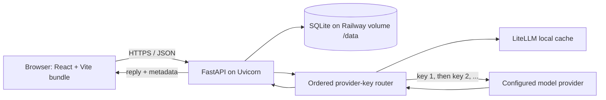

# LOCUSS AI

LOCUSS AI is a full-stack conversational AI application with a React chat interface and a FastAPI service. The backend routes requests through an ordered provider-key pool, uses LiteLLM's local response cache, and stores successful conversations in SQLite.

## 1. Live project

| Component | URL |
|---|---|
| Web app | [https://locuss.up.railway.app](https://locuss.up.railway.app/) |
| Backend API | [https://bot-backend.up.railway.app](https://bot-backend.up.railway.app/) |
| Backend health | [https://bot-backend.up.railway.app/health](https://bot-backend.up.railway.app/health) |
| Public source repository | [github.com/Abhinav23356/Chat-bot](https://github.com/Abhinav23356/Chat-bot) |

The frontend and backend are separate Railway services. The backend's SQLite database is stored on a persistent volume mounted at `/data`.

## 2. At a glance

- **2 application services:** a Vite-built React frontend served by Nginx, and a Python FastAPI backend served by Uvicorn.
- **3 HTTP routes:** health check, chat completion, and session message retrieval.
- **2 or more provider keys:** tried in configured order to provide fallback when a key or provider call fails.
- **2 SQLite tables:** `sessions` and `messages`, with a session-and-message-order index.
- **1 request history per session:** prior successful user and assistant turns are included in later model requests for that session.
- **1 optional request header:** `X-Simulate-Failure` exercises provider failover when the feature switch is enabled.
- **1 generated session ID per page load:** the browser starts a new conversation ID on each load; the API can retrieve persisted history by ID.

## 3. Architecture



### 3.1 Frontend

The frontend is a single-page React application built with Vite and served in production by Nginx on port **3000**. It calls the backend directly using `VITE_API_BASE_URL` and sends JSON to `/chat`.

The interface includes:

1. A live backend connection indicator, refreshed every **8 seconds** through `/health`.
2. A generated session ID shown in the conversation header.
3. A chat composer with Enter-to-send and Shift+Enter for a new line.
4. Three suggested first prompts for writing, explanations, and problem solving.
5. An optional system-prompt editor, applied to the conversation's model context.
6. Markdown rendering for assistant replies.
7. Per-reply provenance: resolution source, model, latency, token counts, and provider key ID when a live provider call was made.
8. A failover demonstration switch that sends `X-Simulate-Failure: key_1=429` with chat requests.

The frontend keeps the current page's displayed messages in browser memory. Persisted history can be fetched from the backend API; the visible History rail item is currently a placeholder and does not provide a session browser.

### 3.2 Backend request lifecycle

For each `POST /chat` request, the backend:

1. Validates and trims the session ID, message, and optional system prompt.
2. Loads the stored system prompt and prior successful turns for that session. If no prompt was stored or submitted, it uses: `You are a helpful assistant. Be clear, accurate, and concise.`
3. Builds the model context in this order: **system prompt → prior turns → current user message**.
4. Calls the configured model through LiteLLM, trying provider keys in order. Failed attempts advance to the next key.
5. On success, records the user message and assistant reply in one SQLite transaction, along with assistant metadata.
6. Returns the reply, session ID, and metadata as JSON.

If every key fails, the service returns HTTP **503** with `{"detail":"all providers unavailable"}`. A failed request is not added to conversation history. If generation succeeds but SQLite persistence fails, the service returns HTTP **503** with `{"detail":"unable to store conversation"}`.

### 3.3 Provider fallback and failure simulation

Set `LLM_API_KEYS` to a comma-separated list. The service names them `key_1`, `key_2`, and so on, in the same order. Credentials are passed to LiteLLM and are not returned in API responses. A successful live reply reports the key ID used and the number of failed attempts before success.

For controlled demonstrations, set `ENABLE_FAILURE_SIMULATION=true` and send one of these comma-separated header values:

| Header value | Effect for this request |
|---|---|
| `key_1=429` | Simulate a rate limit on the first key; try the next configured key. |
| `key_1=500,key_2=502` | Simulate failures on the first two keys; continue to any later key. |
| `*=429` | Simulate a rate limit for every configured key; return 503 if no key remains. |

Accepted simulated statuses are **429, 500, 502, and 503**. Invalid values return HTTP **422**. Simulation is request-scoped and does not consume or alter provider credentials. When simulation is used, caching is bypassed for that request so the test exercises routing. The frontend demonstration switch simulates only `key_1=429`; use `curl` to demonstrate other cases.

### 3.4 Response cache

LiteLLM is configured with a **local in-memory cache**. When a request matches a cached model request, the response metadata reports `LLM_CACHE`; a provider response reports `LIVE_INFERENCE`. Cache entries are process-local and are lost when the backend process restarts. The backend runs with **one Uvicorn worker**, so requests share that worker's cache.

The cache is keyed by the model request context. Repeating only the same message in a different session does **not** guarantee a hit: the session ID itself is not sent to the model, but the system prompt and prior conversation turns are. A repeat is cache-eligible when the effective model request matches. Failure-simulation requests bypass cache lookup and writes.

## 4. API contract

### `GET /health`

Checks SQLite availability and provider configuration. A healthy response is HTTP **200**:

```json
{"status":"ok","keys_configured":2,"cache_enabled":true}
```

The implementation requires at least **2 configured keys** for health to report healthy. It returns HTTP **503** when the database, provider key pool, or LiteLLM setup is unavailable.

### `POST /chat`

Request body:

```json
{
  "session_id": "s-example-session",
  "message": "Explain the difference between caching and persistence.",
  "system_prompt": "You are a concise technical tutor."
}
```

`system_prompt` is optional. `session_id` must contain **1–128 characters**; `message` must contain **1–4,000 characters**; `system_prompt` may contain up to **4,000 characters**. Blank session IDs or messages are rejected with HTTP **422**.

Successful response (HTTP **200**):

```json
{
  "session_id": "s-example-session",
  "reply": "Caching reuses a matching model response; persistence stores conversation data for later retrieval.",
  "metadata": {
    "resolution_source": "LIVE_INFERENCE",
    "model": "gemini/gemini-3.5-flash-lite",
    "latency_ms": 842,
    "input_tokens": 46,
    "output_tokens": 19,
    "key_id": "key_1",
    "fallback_attempts": 0
  }
}
```

`resolution_source` is `LIVE_INFERENCE` or `LLM_CACHE`. `key_id` is `null` for cache hits. Token counts are returned from provider usage when available and otherwise estimated. `latency_ms` is **0** for cache hits.

### `GET /sessions/{session_id}/messages`

Returns successful turns in insertion order. Assistant messages include their saved metadata; user messages do not.

```json
{
  "session_id": "s-example-session",
  "messages": [
    {"role": "user", "content": "Hello"},
    {"role": "assistant", "content": "Hi!", "metadata": {"resolution_source": "LIVE_INFERENCE"}}
  ]
}
```

An unknown session returns HTTP **404** with `{"detail":"session not found"}`.

## 5. Data model and persistence

SQLite is the application's persistence layer. `DATABASE_URL` must use a `sqlite:///` URL.

| Table | Stored fields | Purpose |
|---|---|---|
| `sessions` | `session_id` primary key, `system_prompt`, `created_at` | Stores the session prompt and creation time. |
| `messages` | auto-increment `id`, `session_id`, `role`, `content`, optional JSON `metadata`, `created_at` | Stores user and assistant turns in order. |

The index `idx_messages_session_id_id` accelerates ordered history reads. SQLite uses **WAL** journal mode. Locally, Docker Compose mounts a named volume at `/data`; on Railway, attach a persistent volume at `/data` and set `DATABASE_URL=sqlite:////data/app.db`. Without a persistent volume, container-local database files may not survive replacement of the container.

## 6. Technology stack

| Layer | Technologies |
|---|---|
| User interface | React **18.3**, Vite **6.1**, React Markdown **10.1** |
| API | Python **3.12**, FastAPI **0.115**, Uvicorn **0.34** |
| Model adapter | LiteLLM **1.83** |
| Database | SQLite, Python `sqlite3` |
| Containers | Docker multi-stage builds, Docker Compose |
| Production serving | Nginx **1.27** for the frontend; Uvicorn for the backend |
| Hosting | Railway frontend and backend services; persistent backend volume |

## 7. Run locally

### Requirements

1. Docker and Docker Compose.
2. At least **2 valid model-provider API keys** in the configured provider format.

### Start the stack

From the repository root:

```bash
cp .env.example .env
```

Edit `.env` and replace the example `LLM_API_KEYS` values with valid credentials. Then run:

```bash
make up
```

Open [http://localhost:3000](http://localhost:3000). The API listens on [http://localhost:8000](http://localhost:8000), and its health check is [http://localhost:8000/health](http://localhost:8000/health).

Stop the services with:

```bash
make down
```

The named `sqlite_data` volume is retained by `docker compose down`; removing volumes explicitly will delete the local database and its conversation records.

## 8. Configuration

| Variable | Default | Description |
|---|---|---|
| `LLM_API_KEYS` | empty | Comma-separated provider API keys, tried in order. Configure at least **2** for a healthy status. |
| `LLM_MODEL` | `gemini/gemini-3.5-flash-lite` | LiteLLM model identifier. |
| `DATABASE_URL` | `sqlite:////data/app.db` | SQLite database location. |
| `ALLOWED_ORIGINS` | `http://localhost:3000` | Comma-separated browser origins allowed by backend CORS. Set this to the deployed frontend origin in production. |
| `ENABLE_FAILURE_SIMULATION` | `false` | Enables the request-scoped `X-Simulate-Failure` hook. |
| `PORT` | `8000` | Backend listening port; Railway supplies its assigned port. |
| `VITE_API_BASE_URL` | `http://localhost:8000` | Public backend base URL compiled into the frontend bundle. |

The frontend value `VITE_API_BASE_URL` is a **build-time** setting. Changing it in a running container without rebuilding the frontend does not update the bundle.

## 9. Railway deployment notes

Deploy the frontend and backend as **2 services** from this repository:

1. Backend root directory: `/backend`. Provide `LLM_API_KEYS`, `LLM_MODEL`, `DATABASE_URL`, `ALLOWED_ORIGINS`, and (for assignment demonstrations) `ENABLE_FAILURE_SIMULATION=true`.
2. Attach a backend persistent volume mounted at `/data`. Set `DATABASE_URL=sqlite:////data/app.db`.
3. Set backend `ALLOWED_ORIGINS` to the frontend's public origin, for example `https://locuss.up.railway.app`.
4. Frontend root directory: `/frontend`. Set build argument/environment `VITE_API_BASE_URL=https://bot-backend.up.railway.app`, then redeploy/rebuild.
5. Generate a public HTTP domain for each service on its listening port (backend uses Railway's `PORT`; frontend listens on **3000**).

Never commit provider keys. Add secrets in the hosting provider's variable settings. The repository's `.env.example` contains placeholders only.

## 10. Development and verification

The backend's API contract tests are in `backend/tests/test_api.py`; developer dependencies are listed in `backend/requirements-dev.txt`. To run them in a local Python environment:

```bash
cd backend
python -m pip install -r requirements-dev.txt
python -m pytest
```

The tests cover the successful chat/history contract, cache metadata, request validation, simulated fallback to the second key, and all-keys-failed behavior without persisting a failed turn. These tests mock the model provider; they do not require live provider credentials.

Build the frontend bundle with:

```bash
cd frontend
npm install
npm run build
```

## 11. Repository layout

```text
.
├── backend/
│   ├── app/main.py          # FastAPI routes, provider routing, cache, SQLite persistence
│   ├── tests/test_api.py    # API contract tests
│   ├── Dockerfile           # Multi-stage Python backend image
│   └── requirements*.txt    # Runtime and development dependencies
├── frontend/
│   ├── src/main.jsx         # React application and API calls
│   ├── src/styles.css       # Responsive visual design
│   ├── Dockerfile           # Vite build and Nginx runtime image
│   └── nginx.conf           # SPA routing and port 3000 listener
├── docker-compose.yml       # Local 2-service stack and SQLite volume
├── .env.example             # Local configuration template
└── Makefile                 # make up / make down shortcuts
```

## 12. Design boundaries

- The backend accepts only **SQLite** database URLs; it is designed to persist via a mounted file volume.
- The cache is **in-memory and process-local**, while conversation history is stored in SQLite.
- A new browser page load creates a new session ID. The API supports reading history when the session ID is known, but the current frontend does not yet offer a session list or restore-history screen.
- Failure simulation is disabled by default and should be enabled only where the assignment's failover demonstration is needed.
- The local cache and single-worker configuration are intended for this small assignment deployment; they are not a distributed cache or multi-instance coordination layer.
